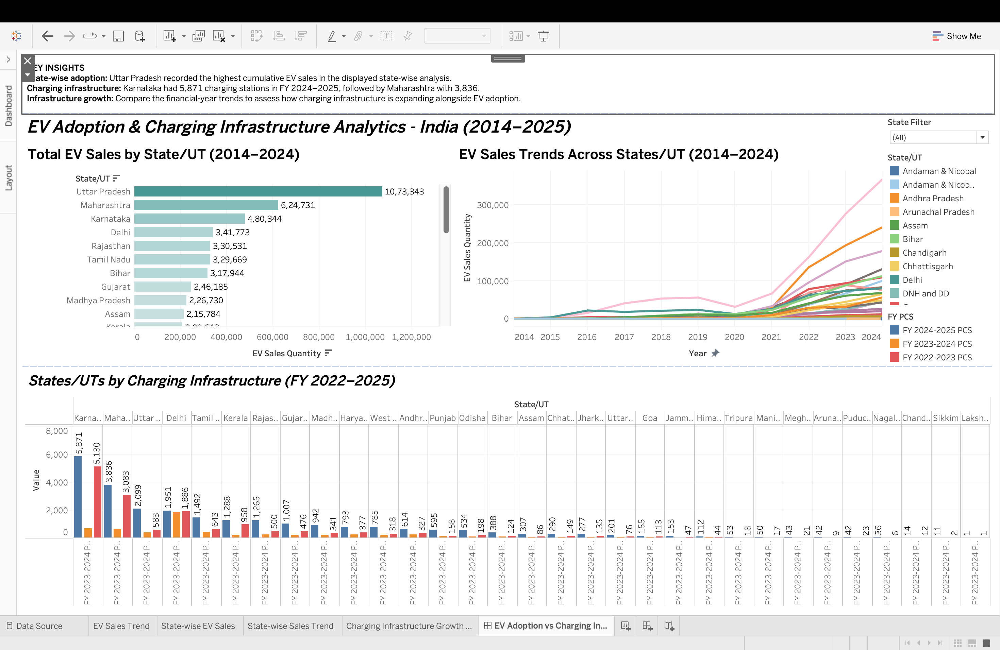

# 🚗 EV Sales Forecasting and Charging Infrastructure Prediction

## 📖 Overview

This project focuses on forecasting Electric Vehicle (EV) sales and predicting charging infrastructure requirements using historical data. It combines data preprocessing, exploratory data analysis (EDA), statistical forecasting, and machine learning techniques to analyze EV adoption trends and support future infrastructure planning.

---

## 🎯 Objectives

- Analyze historical EV sales and charging infrastructure data.
- Identify trends, seasonality, and growth patterns.
- Forecast future EV sales using time-series models.
- Predict future charging infrastructure requirements.
- Compare multiple forecasting models using standard evaluation metrics.

---

## 🛠️ Tech Stack

- **Programming Language:** Python
- **Development Environment:** Google Colab

### Libraries Used

- Pandas
- NumPy
- Matplotlib
- Seaborn
- Plotly
- Scikit-learn
- Statsmodels
- TensorFlow
- XGBoost

---

## 📊 Project Features

- Data Cleaning & Preprocessing
- Exploratory Data Analysis (EDA)
- Time Series Analysis
- EV Sales Forecasting
- Charging Infrastructure Prediction
- Model Performance Evaluation
- Data Visualization

---

## 🤖 Forecasting Models

The following models were implemented and evaluated:

- ARIMA / SARIMA
- Holt-Linear
- XGBoost Regression
- LSTM (Long Short-Term Memory)
- GRU (Gated Recurrent Unit)

---

## 📏 Evaluation Metrics

The forecasting models were evaluated using:

- Mean Absolute Error (MAE)
- Root Mean Squared Error (RMSE)
- Mean Absolute Percentage Error (MAPE)

---

## 📂 Repository Contents

```
.
├── Time_Series_Project.ipynb
├── EV_Sales.csv
├── Charging_Stations.csv
├── requirements.txt
└── README.md
```
---

### 1. Clone the Repository

```bash
git clone https://github.com/Samridhii-20/EV-Sales-and-Charging-Infrastructure-Prediction.git
```

### 2. Navigate to the Project Directory

```bash
cd EV-Sales-and-Charging-Infrastructure-Prediction
```

### 3. Install Required Libraries

```bash
pip install -r requirements.txt
```

### 4. Run the Notebook

Open `Time_Series_Project.ipynb` using **Google Colab** or **Jupyter Notebook** and execute all cells.

---

## 📈 Results

The project provides:

- Historical trend analysis of EV sales.
- Charging infrastructure growth analysis.
- Future EV sales forecasts.
- Charging infrastructure demand prediction.
- Performance comparison of multiple forecasting models.

---

## Tableau Dashboard: EV Adoption & Charging Infrastructure Analytics

Developed an interactive Tableau dashboard to explore EV adoption
and public charging infrastructure across Indian states and UTs.

### Dashboard Features
- State-wise EV sales analysis across India
- State-wise EV sales trends over time (2014 - 2024)
- Comparison of public charging infrastructure across FY 2022–2025
- Interactive state filter to explore individual states

### Dashboard Preview


### How to View
Download the packaged Tableau workbook (`.twbx`) from this repository
and open it using Tableau Desktop.

---


## 🔮 Future Scope

- Deploy the forecasting model using Streamlit or Flask.
- Integrate real-time EV registration data.
- Develop state-wise forecasting models.
- Create an interactive dashboard.
- Automate model retraining with updated datasets.

---

## 👩‍💻 Author

**Samridhi Choudhary**

B.Tech Computer Science (Data Science)

Bennett University

---
